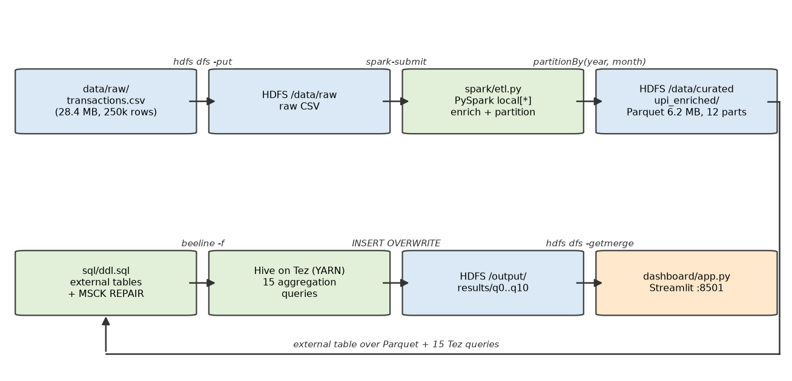
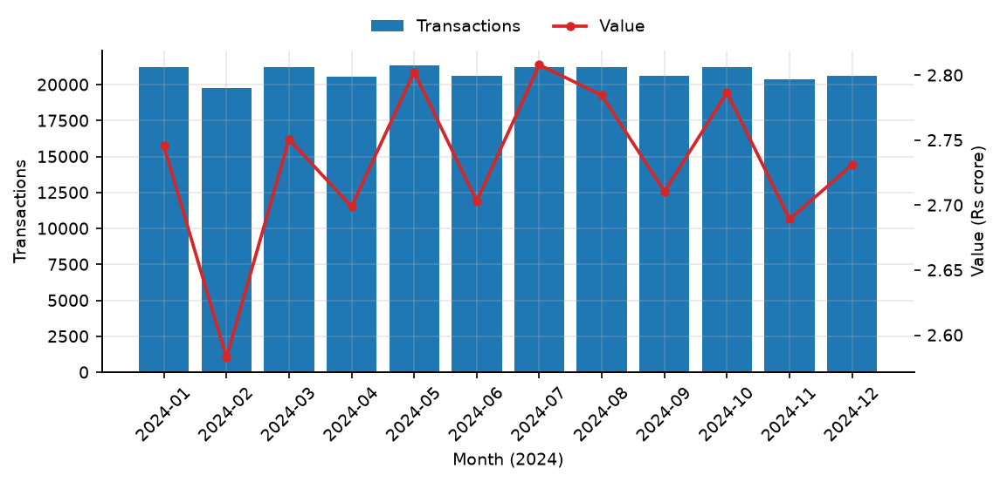
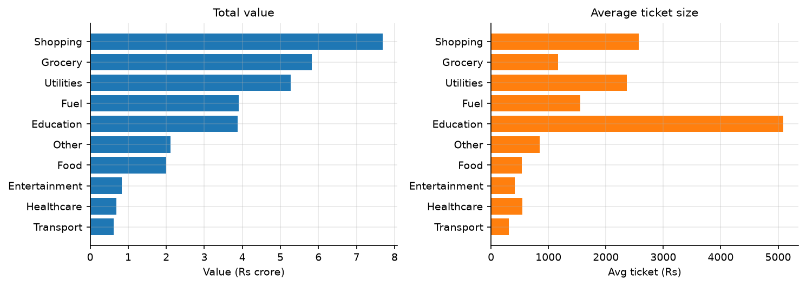
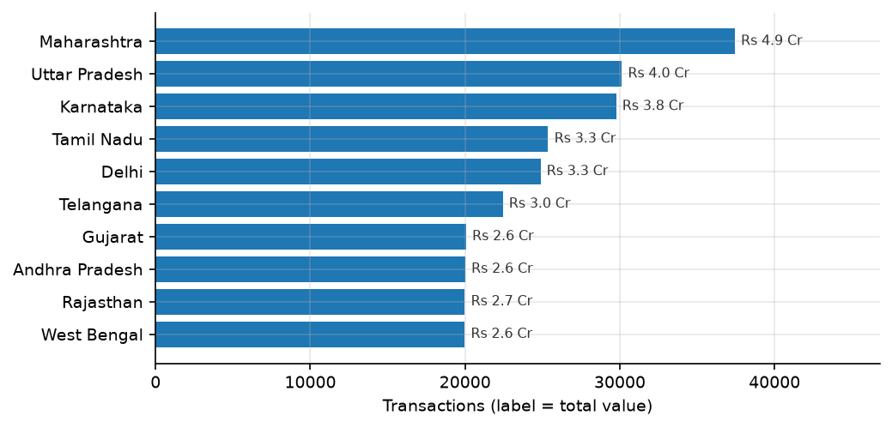
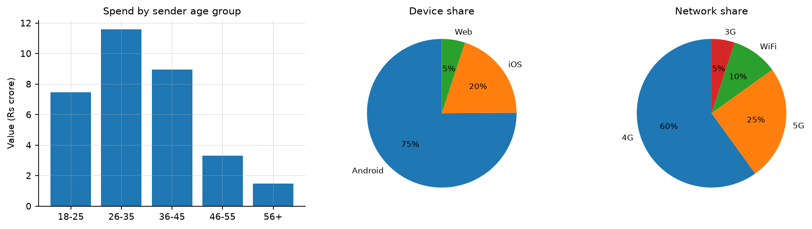
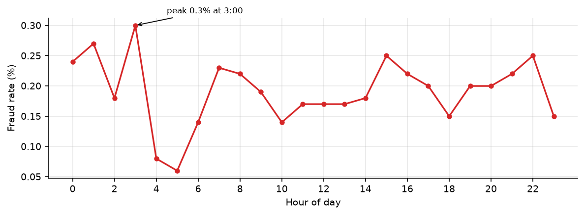

# Analyzing Indian Consumer UPI Transactions Using Hadoop to Identify Spending Patterns, Customer Behaviour, and Sales Trends

**Abstract—** The Unified Payments Interface (UPI) has become the dominant retail
payment rail in India, generating transaction streams that exceed the practical
limits of single-process analysis. This paper presents an end-to-end big-data
analytics pipeline that applies the Hadoop ecosystem to a corpus of 250,000 Indian
UPI transactions (28.4 MB, one calendar year, 10 states, 8 banks) to identify
spending patterns, customer behaviour, and sales trends. The pipeline runs
pseudo-distributed on a single machine: Apache Hadoop 3.5.0 provides HDFS storage
and YARN resource management, Apache PySpark 4.2.0 performs row-level ETL and
partitions the data into columnar Parquet (28.4 MB → 6.2 MB), and Apache Hive
4.1.0 executes 15 aggregation queries as Tez DAGs. The cluster configuration is
documented in full so the work is reproducible on modest hardware. Analysis of the
full corpus (₹327.94 crore across 250,000 transactions) finds a stable monthly
demand profile (±4 % band), a sharp split between volume categories (Grocery) and
value categories (Shopping, Education), a 26–45-year-old cohort that contributes
60 % of transactions and 63 % of value, a mode-independent ~5 % failure rate, and
fraud risk concentrated in low-activity night hours rather than in any category or
region. Results are published as an interactive Streamlit dashboard driven solely
by the aggregate outputs of the Hadoop engines.

**Keywords—** UPI; Hadoop; HDFS; Apache Hive; Apache Spark; Apache Tez; YARN;
transaction analytics; dashboard

---

## I. INTRODUCTION

Digital payments in India have undergone an abrupt structural shift. UPI, operated
under the National Payments Corporation of India (NPCI), now processes billions of
transactions per month across person-to-person (P2P) and merchant (P2M) channels
[1]. For a bank, a fintech, or a researcher, this stream is a rich behavioural
signal — but it arrives at a scale and velocity that a single-machine, row-at-a-time
program cannot economically interrogate.

The Hadoop ecosystem was created for exactly this class of problem. MapReduce
established the model of shipping computation to the data and aggregating it in
parallel across a cluster [2]; its descendants — HDFS for storage, YARN for
resource scheduling, Hive for declarative SQL, and Spark for iterative, in-memory
processing — form the standard industrial toolkit for large-scale data analytics.

This project asks a concrete question: *what can 250,000 real-shaped UPI
transactions tell us about how Indian consumers spend, and what does it take to
compute those answers correctly on the Hadoop stack?* The second clause matters as
much as the first — a large share of the engineering effort in this work was
cluster configuration (HDFS, YARN, Hive, Tez and their interaction), and that
configuration is documented here as a first-class contribution rather than
buried in appendix material.

The contributions of this paper are:

1. An end-to-end, single-command pipeline in which a PySpark ETL stage writes
   partitioned Parquet into HDFS and Hive-on-Tez consumes it through external
   tables, with no data copied between engines.
2. A complete, reproducible specification of the pseudo-distributed Hadoop
   component configurations (HDFS, YARN, MapReduce, Hive, Tez) required to run
   the workload on a 4 GB laptop cluster.
3. A 15-query analytical study of 250,000 transactions covering sales trends,
   category and geographic spend, customer behaviour, failure and fraud risk, and
   Spark-derived spending segments.
4. An interactive dashboard that renders only the small aggregate outputs produced
   by the Hadoop engines.

The remainder of this paper is organised as follows. Section II defines the
project scope and research questions. Section III describes the dataset. Section IV
presents the tools, methodology, pipeline architecture, and cluster configuration.
Section V reports and discusses the results. Section VI concludes with limitations
and future work.

## II. PROJECT DEFINITION

**Problem statement.** A raw corpus of UPI transactions is a flat CSV with 17
heterogeneous fields and no pre-computed insight. Answering questions about
spending patterns, customer behaviour, and sales trends requires aggregation over
hundreds of thousands of rows across multiple dimensions (time, category,
geography, demographic, device, bank, outcome, risk), and the pipeline must do so
using big-data frameworks rather than a single-process script.

**Objectives.**

- **O1.** Build a working Hadoop cluster (HDFS + YARN) and load the corpus into
  distributed storage.
- **O2.** Implement an ETL layer that cleans, types, and derives analytical
  columns, writing partitioned columnar output back to HDFS.
- **O3.** Execute distributed SQL aggregations that answer the analytical
  questions and export the results for visualisation.
- **O4.** Present the results as an interactive dashboard.

**Research questions.**

- **RQ1 (Sales trends).** How does transaction volume and value evolve across the
  year — is there seasonality or growth?
- **RQ2 (Spending patterns).** Which categories, ticket-size bands, and regions
  dominate on value versus volume, and how do they differ in average ticket size?
- **RQ3 (Customer behaviour & risk).** Which payment modes, age cohorts, devices,
  and banks dominate usage, and where do failures and fraud concentrate?

**Scope.** Aggregate-level analysis of one year of transactions on a
pseudo-distributed single-node cluster. Out of scope: row-level per-customer
profiling (RFM, churn), streaming/real-time ingestion, and multi-node scaling.

## III. DATASET

The corpus is `data/raw/transactions.csv` — 250,000 rows × 17 columns, 28.4 MB,
spanning 2024-01-01 to 2024-12-30, with 10 states, 10 merchant categories, 8 banks,
and 4 transaction modes. The file is staged into HDFS [3] at
`hdfs:///data/raw/transactions.csv` before any processing.

**TABLE I.** Dataset schema (250,000 rows, 17 columns)

| Column | Example | Notes |
| --- | --- | --- |
| transaction id | TXN0000000001 | unique key |
| timestamp | 2024-10-08 15:17:28 | parsed to `TIMESTAMP` |
| transaction type | P2P, P2M, Bill Payment, Recharge | 4 modes |
| merchant_category | Shopping, Grocery, … | 10 categories |
| amount (INR) | 868 | range 10 – 42,099 |
| transaction_status | SUCCESS / FAILED | 2 outcomes |
| sender/receiver_age_group | 26-35 | 5 buckets (18-25 … 56+) |
| sender_state | Delhi | 10 states |
| sender_bank / receiver_bank | Axis / SBI | 8 banks |
| device_type | Android, iOS, Web | |
| network_type | 4G, 5G, WiFi, 3G | |
| fraud_flag | 0 / 1 | 480 flagged |
| hour_of_day, day_of_week, is_weekend | 15, Tuesday, 0 | derived time fields |

**Data quality.** A pre-flight check verified that no field is quoted, every row
has exactly 17 delimited fields, and no transaction id is missing — conditions
that make a plain delimited Hive table (no CSV SerDe) safe for the raw layer.
The header row contains spaces and parentheses (`amount (INR)`, `transaction id`),
which the ETL stage normalises (Section IV-D).

## IV. TOOLS AND METHODOLOGY

### A. Technology Stack

**TABLE II.** Technology stack and rationale

| Layer | Choice | Rationale |
| --- | --- | --- |
| Storage | Hadoop 3.5.0 HDFS (replication 1, pseudo-distributed) | raw CSV, curated Parquet, query output |
| ETL | PySpark 4.2.0 (`local[*]`) | enrich + partition raw CSV into Parquet |
| Processing | Hive 4.1.0 on Tez 0.10.5 (YARN) | distributed SQL; each query = one Tez DAG |
| Metadata | Hive metastore (Derby), external tables | schema imposed without moving data |
| Orchestration | `scripts/run_pipeline.sh` | one command, idempotent |
| Presentation | Streamlit 1.65 + pandas 3 + Plotly 7 | reads only the small aggregate CSVs |

Hive provides a SQL interface over Hadoop's storage layer [4], with Tez [5] as the
low-latency DAG execution engine in place of classic MapReduce [2]. PySpark [6]
handles the row-level enrichment pass, because iterative, record-at-a-time
transformations are where Spark's in-memory model outperforms SQL. Streamlit [7]
is used only for presentation. The design principle throughout: *the heavy lifting
stays inside the big-data engines* — Python/pandas never touches data larger than
the final aggregate CSVs.

### B. Pipeline Architecture

The pipeline has six stages, orchestrated end-to-end by `scripts/run_pipeline.sh`
(~150 seconds wall-clock on this machine).

**Fig. 1.** End-to-end pipeline. Local CSV is staged into HDFS, enriched by a
PySpark job into partitioned Parquet, registered as Hive external tables, and
aggregated by 15 Tez queries; results are merged out of HDFS and rendered by the
dashboard. Green boxes are code artefacts, blue boxes are data at rest, orange is
the presentation layer.

1. **Ingest** — `hdfs dfs -put` stages the CSV at `hdfs:///data/raw`.
2. **Spark ETL** — `spark-submit --master 'local[*]' spark/etl.py` reads the raw
   CSV from HDFS, normalises the header names to match the Hive schema, derives
   ten extra columns, and writes Parquet partitioned by `year`/`month` to
   `hdfs:///data/curated/upi_enriched` (28.4 MB → 6.2 MB across 12 partitions).
3. **Schema** — `sql/ddl.sql` creates two external tables (`upi.transactions` over
   the raw CSV with `skip.header.line.count=1`, `upi.transactions_enriched` over
   the Parquet) and registers partitions with `MSCK REPAIR TABLE`. Hive reads
   metadata only; no data is copied.
4. **Analysis** — `sql/analysis.sql` runs 15 `INSERT OVERWRITE DIRECTORY` queries;
   each executes as a Tez DAG on YARN and writes CSV output to
   `hdfs:///output/results/<qN>`.
5. **Export** — `hdfs dfs -getmerge` flattens each result directory into
   `data/processed/*.csv`.
6. **Visualisation** — `dashboard/app.py` loads the CSVs (cached) and renders six
   tabs.

Stage timings: services + upload ~10 s, Spark ETL ~40 s, DDL + MSCK ~15 s, 15 Tez
queries ~75 s, export ~5 s.

### C. Hadoop Cluster Configuration

Everything runs pseudo-distributed on one laptop, so every default that assumes a
real cluster was tuned down to fit a 4 GB container budget. Configuration follows
the documented Hadoop reference settings [8]; files live in
`$HADOOP_HOME/etc/hadoop/`, `$HIVE_HOME/conf/`, and `tez-conf/`.

**TABLE III.** HDFS and YARN configuration

| Component | Property | Value | Why |
| --- | --- | --- | --- |
| HDFS | `fs.defaultFS` | `hdfs://localhost:9000` | single-node cluster endpoint used by every client (Hive, Spark, beeline) |
| HDFS | `hadoop.proxyuser.niru.hosts/groups` | `*` | lets the OS user submit jobs on behalf of itself (HiveServer2/Tez) |
| HDFS | `dfs.replication` | `1` | one DataNode only — replication would just waste disk |
| HDFS | `dfs.namenode.name.dir` | `file:///…/hdfs/namenode` | NameNode metadata outside the install dir, survives Hadoop upgrades |
| HDFS | `dfs.datanode.data.dir` | `file:///…/hdfs/datanode` | block storage (raw CSV + curated Parquet + query output) |
| YARN | `yarn.nodemanager.resource.memory-mb` | `4096` | whole-laptop container budget for Tez/Spark/MR tasks |
| YARN | `yarn.scheduler.maximum-allocation-mb` | `4096` | no single container may exceed the NodeManager budget |
| YARN | `yarn.nodemanager.vmem-check-enabled` | `false` | virtual-memory accounting kills JVM containers spuriously |
| YARN | `yarn.nodemanager.aux-services` | `mapreduce_shuffle` | shuffle service for MapReduce-style reducers |
| YARN | `yarn.log-aggregation-enable` | `true` | container logs pulled to HDFS for post-mortem debugging |

**TABLE IV.** MapReduce, Hive, and Tez configuration

| Component | Property | Value | Why |
| --- | --- | --- | --- |
| MapReduce | `mapreduce.framework.name` | `yarn` | submit to the cluster, never `local` |
| MapReduce | `mapreduce.map/reduce.memory.mb` | `512` (heap `-Xmx384m`) | small tasks so several run concurrently in the 4 GB budget |
| MapReduce | `mapreduce.*.env` | `JAVA_HOME`, `HADOOP_MAPRED_HOME` | containers inherit the JDK 17 path |
| Hive | `javax.jdo.option.ConnectionURL` | embedded Derby | no separate metastore service needed |
| Hive | `hive.metastore.warehouse.dir` | `/user/hive/warehouse` | default table location in HDFS |
| Hive | `hive.server2.enable.doAs` | `false` | single-user setup, avoids impersonation plumbing |
| Hive | scratch/query-log dirs | `/tmp/niru` | writable scratch space for HiveServer2 |
| Tez | `tez.lib.uris` | `${fs.defaultFS}/apps/tez/tez-minimal.tar.gz` | Tez ships to containers from HDFS (staged once with `-put`) |
| Tez | `tez.use.cluster.hadoop-libs` | `true` | reuse the cluster's Hadoop jars instead of bundling copies |
| Tez | `HADOOP_CLASSPATH` | `$TEZ_CONF_DIR:$TEZ_HOME/*:$TEZ_HOME/lib/*` | without this, Hive cannot find the Tez AM classes |

Two operational notes. First, Hive 4 removed the classic CLI: all SQL flows
through `beeline` → HiveServer2 (`localhost:10000`) → Tez, and the pipeline starts
HiveServer2 if it is down. Second, environment variables (`JAVA_HOME`,
`HADOOP_HOME`, `HADOOP_CONF_DIR`, `HIVE_HOME`, `TEZ_HOME`, `TEZ_CONF_DIR`,
`SPARK_HOME`, `PYSPARK_PYTHON`) are exported in `~/.zshrc` and re-defaulted inside
`run_pipeline.sh`, so the pipeline also works from a bare shell — note that
pip-installed PySpark cannot self-locate, hence the explicit `SPARK_HOME`.

### D. Data Processing and Query Logic

**Spark ETL (`spark/etl.py`).** The job reads the raw CSV with an inferred schema
and normalises five header names to match the Hive queries
(`transaction id` → `txn_id`, `transaction type` → `txn_type`,
`amount (INR)` → `amount`, `transaction_status` → `txn_status`,
`timestamp` → `ts`). It then derives ten analytical columns: `transaction_date`,
`month_name`, `quarter`, `week_of_year`, `day_type` (Weekday/Weekend),
`is_peak_hour` (17:00–21:00), `amount_category` (Small < ₹500, Medium ₹500–1,999,
Large ≥ ₹2,000), `is_successful`, and the `year`/`month` partition keys. Output is
written with `partitionBy("year", "month")`. A built-in assert fails the job if any
`ts` or `txn_status` value is null, which catches
Spark↔Hive column-name drift at the source rather than as silent NULL aggregates.

**Hive analysis (`sql/analysis.sql`).** 15 queries over
`upi.transactions_enriched`, each writing one CSV directory:

| Group | Queries | Question answered |
| --- | --- | --- |
| Overview | q0_kpis | headline numbers for the dashboard banner |
| Trends | q1_monthly | spend growth/seasonality (GROUP BY Spark partition columns) |
| Patterns | q3_category, q4_state, q10_amount, q10_daytype | category/state concentration, ticket-size brackets, weekday vs weekend |
| Behaviour | q5_type, q5b_age, q6_device, q6_network, q7_bank | mode, cohort, device, network, and bank share |
| Risk | q8_status, q9_fraud_category, q9_fraud_hour, q9_fraud_state | failure rate per mode; fraud by category, hour, state |

Every query is a pure `GROUP BY` aggregation with `INSERT OVERWRITE DIRECTORY`
output — no `UNION ALL` (its subdirectories break the flat `getmerge` export).
Queries are submitted through `beeline -f` and execute as Tez DAGs on YARN, with
each stage of each DAG running as 512 MB containers inside the 4 GB NodeManager
budget.

## V. RESULTS AND DISCUSSION

All figures in this section are generated from the exported query results by
`scripts/make_figures.py`, so the plotted values are exactly the values computed
by Hive/Tez.

### A. Headline Numbers

**TABLE V.** Corpus overview (query q0_kpis)

| Metric | Value |
| --- | --- |
| Transactions | 250,000 |
| Total value | ₹327.94 crore (₹327,939,009) |
| Average ticket | ₹1,311.76 |
| Success rate | 95.05 % (12,376 failures) |
| Fraud-flag rate | 0.19 % (480 transactions) |
| States / banks | 10 / 8 |

### B. Sales Trends (RQ1)

**Fig. 2.** Monthly transaction volume (bars) and total value (line), 2024.

Monthly volume is remarkably flat: 19,759 transactions in February (lowest)
against 21,333 in May (highest) — a ±4 % band around the mean. There is no strong
seasonality in this corpus, only a small February dip and May/October highs; value
tracks volume almost perfectly, so the average ticket size is stable across the
year. For a payments business this is a predictable-demand regime: capacity can be
planned on trend, and any month-to-month deviation of more than a few percent
would be a genuine anomaly rather than seasonality.

### C. Spending Patterns — Categories (RQ2)

**Fig. 3.** Total value (left) and average ticket size (right) by merchant category.

Volume and value live in different categories. **Shopping leads on value**
(₹76.86 Cr from 29,872 transactions) while **Grocery leads on volume** (49,966
transactions, 20 % of the corpus, ₹58.28 Cr). Average ticket size varies 17× across
categories: Education (₹5,094) and Utilities (₹2,361) are high-value,
low-frequency payments; Transport (₹308), Entertainment (₹413), and Food (₹532)
are frequent low-value payments. The distribution has a classic long-tail shape —
the top three categories account for 57 % of value, while Food's 37,464
transactions produce only ₹19.92 Cr.

### D. Geography (RQ2)

**Fig. 4.** Transaction count by sender state (labels show total value).

Maharashtra (₹49.04 Cr, 37,427 transactions) is the clear leader, followed by
Uttar Pradesh (₹40.04 Cr) and Karnataka (₹38.45 Cr). The distribution is
otherwise even — the bottom four states all sit within 19,972–20,061
transactions — so volume concentrates in a top-5 cluster of 147,545 transactions
(59 % of the corpus).

### E. Customer Behaviour (RQ3)

**Fig. 5.** Spend by sender age group (left), device share (centre), and network
share (right).

**Payment mode.** P2P dominates with 112,445 transactions (45 %) and ₹147.15 Cr of
value, against P2M 87,660 (35 %), Bill Payment 37,368 (15 %), and Recharge 12,527
(5 %). Average ticket sizes are nearly identical across modes (₹1,291–₹1,320), so
mode choice reflects *purpose*, not *amount*.

**Cohorts.** The 26–35 group is the core segment — 87,432 transactions (35 %) and
₹115.96 Cr (35 % of value) — while 36–45-year-olds spend the most per transaction
(₹1,424). Spend rises with age up to 45 and then falls; the 26–45 cohort together
accounts for 150,305 transactions (60 %) and ₹205.49 Cr (63 % of value).

**Device and network.** Android (75.1 %) and 4G (59.9 %) dominate; iOS holds
19.8 %, 5G has already reached 25 %, and Web is marginal at 5 %.

**Banks.** SBI originates 25.1 % of transactions (62,693), ahead of HDFC (15 %) and
ICICI (11.9 %); the remaining five banks each hold roughly 10 %.

### F. Transaction Failures and Fraud (RQ3)

**TABLE VI.** Failure rate by payment mode (query q8_status)

| Mode | Transactions | Failed | Failure rate |
| --- | --- | --- | --- |
| Recharge | 12,527 | 638 | 5.09 % |
| P2P | 112,445 | 5,575 | 4.96 % |
| P2M | 87,660 | 4,339 | 4.95 % |
| Bill Payment | 37,368 | 1,824 | 4.88 % |

The failure rate is almost perfectly uniform across modes (4.88–5.09 %). Failures
therefore look *systemic* — network or limit related — rather than specific to any
user journey, which points to infrastructure remediation rather than UX fixes.

Fraud is rare (0.19 %) and nearly flat across categories (0.15 % Utilities →
0.21 % Education/Shopping/Transport) and states (0.16 % Tamil Nadu → 0.23 %
Karnataka/Rajasthan, a 0.07 pp spread) — no category or region is a hotspot.

**Fig. 6.** Fraud rate by hour of day (query q9_fraud_hour).

By hour, fraud concentrates at night: 03:00 (0.30 %), 01:00 (0.27 %), and
22:00/15:00 (0.25 %). The night hours carry the fewest transactions overall, so
their disproportionate fraud share is a useful signal for rule-based velocity
checks: a fraud score weighted by hour-of-day would outperform a flat threshold.

### G. Spark-Derived Segments (RQ2)

**TABLE VII.** Ticket-size brackets and day type (queries q10_amount, q10_daytype —
columns derived by the Spark ETL)

| Segment | Transactions | Share of volume | Value (₹ Cr) | Avg ticket (₹) |
| --- | --- | --- | --- | --- |
| Large (≥ ₹2,000) | 49,184 | 19.7 % | 202.32 | 4,113.61 |
| Medium (₹500–1,999) | 94,354 | 37.7 % | 98.13 | 1,040.00 |
| Small (< ₹500) | 106,462 | 42.6 % | 27.49 | 258.19 |
| Weekday | 178,663 | 71.5 % | 234.50 | 1,312.52 |
| Weekend | 71,337 | 28.5 % | 93.44 | 1,309.85 |

Value concentrates hard at the top: Large transactions are under a fifth of volume
but 62 % of value, whereas Small transactions are 42.6 % of volume for just
₹27.49 Cr. The weekday/weekend split (178,663 vs 71,337) matches the natural 5:2
day ratio almost exactly, and average tickets differ by ₹3 — the per-day spending
rate is flat, so weekends neither boost nor suppress activity.

### H. Summary of Insights

1. Spend is stable and predictable across the year — no seasonal swings (RQ1).
2. Volume and value live in different categories: Grocery is a volume play,
   Shopping/Education a value play (RQ2).
3. The 26–45 cohort (60 % of transactions, 63 % of value) is the revenue engine,
   and 36–45 pays the biggest tickets (RQ3).
4. Failures are a flat ~5 % tax on every payment mode — an infrastructure issue,
   not a UX one (RQ3).
5. Fraud risk concentrates in low-activity night hours rather than in any category
   or region (RQ3).

## VI. CONCLUSION AND FUTURE WORK

This paper presented a complete Hadoop-based analytics pipeline for Indian UPI
transaction data and its application to 250,000 transactions worth ₹327.94 crore.
A PySpark ETL layer converted a 28.4 MB raw CSV into 6.2 MB of Parquet partitioned
by year and month in HDFS; Hive registered the data as external tables and executed
15 aggregation queries as Tez DAGs on YARN in roughly 75 seconds; the merged
results drive a Streamlit dashboard. The analysis answered all three research
questions: demand is flat and predictable across the year; spending splits cleanly
between high-volume/low-ticket and low-volume/high-ticket categories; the 26–45
cohort is the dominant segment; failures are mode-independent; and fraud risk is
temporal rather than categorical or geographic. The full cluster configuration —
HDFS, YARN, MapReduce, Hive, and Tez — was documented as a first-class result so
the pipeline can be reproduced on modest hardware.

**Limitations.** The cluster is single-node and pseudo-distributed (replication
1), so fault tolerance and scale-out are not demonstrated. The corpus covers one
year and 10 states, and fraud is rare (480 cases), so fraud rates carry wide
confidence intervals. Analysis is aggregate-level only: per-customer trajectories
(RFM, churn) are out of scope of the current query set.

**Future work.**

- Re-run the same aggregations in Spark SQL instead of Hive/Tez and compare engine
  timings.
- Bucket the enriched table by `sender_state` and push fraud queries down to
  partition pruning.
- Sessionise raw events to derive per-user RFM and churn segments.
- Add YARN capacity/queue monitoring and compare Tez vs MapReduce execution time
  for the same query set.

## REFERENCES

[1] National Payments Corporation of India, "Unified Payments Interface (UPI)
ecosystem," 2024. [Online]. Available: https://www.npci.org.in/what-we-do/unified-payments-interface

[2] J. Dean and S. Ghemawat, "MapReduce: Simplified Data Processing on Large
Clusters," *Commun. ACM*, vol. 51, no. 1, pp. 107–113, 2008.

[3] K. Shvachko, H. Kuang, S. Radia, and R. Chansler, "The Hadoop Distributed
File System," in *Proc. IEEE 26th Annu. Conf. Mass Storage Syst. Technol.
(MSST)*, 2010, pp. 1–10.

[4] A. Thusoo et al., "Hive: A Warehousing Solution Over a Map-Reduce Framework,"
*Proc. VLDB Endow.*, vol. 2, no. 2, pp. 1626–1629, 2009.

[5] Apache Software Foundation, "Apache Tez." [Online]. Available: https://tez.apache.org

[6] M. Zaharia et al., "Apache Spark: A Unified Engine for Big Data Processing,"
*Commun. ACM*, vol. 59, no. 11, pp. 56–65, 2016.

[7] Streamlit Inc., "Streamlit Documentation." [Online]. Available: https://docs.streamlit.io

[8] Apache Software Foundation, "Apache Hadoop 3.5.0 Documentation." [Online].
Available: https://hadoop.apache.org/docs/stable/
